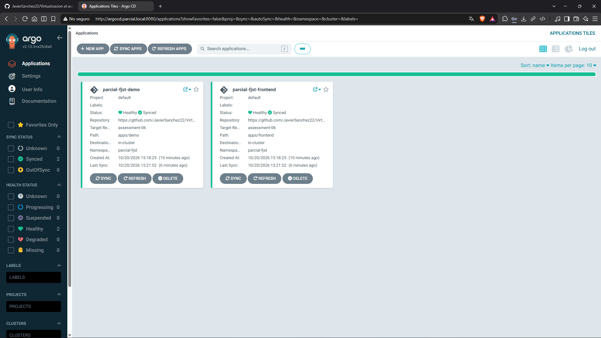
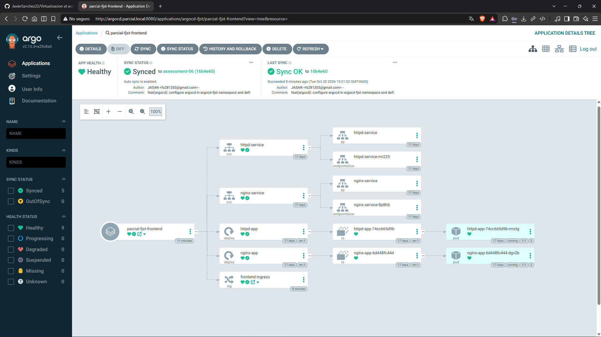
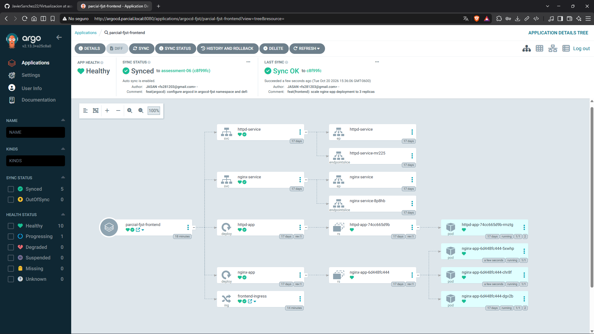

# Assessment 06 - GitOps with Argo CD on Minikube

This repository contains the required configurations to install Argo CD in a local Minikube cluster, expose its web interface through Traefik using MetalLB, and deploy applications into the `parcial-fjst` namespace following a GitOps workflow.

## 1. Environment & Prerequisites
I started from the local Minikube cluster configured in the previous activities, where **MetalLB** (`metallb-system`) provides the external IP `192.168.49.100` to the **Traefik** Ingress Controller (`traefik`).

- **Cluster internal IP**: `192.168.49.2`
- **Traefik LoadBalancer IP**: `192.168.49.100`
- **Argo CD Namespace**: `argocd-fjst`
- **Applications Namespace**: `parcial-fjst`

---

## 2. Repository Structure (IaC)

All configurations are declared as Infrastructure as Code (YAML manifests) organized at the root of the repository:

```text
.
├── metallb/
│   └── metallb-config.yaml           # IPAddressPool (192.168.49.100) and L2Advertisement
├── traefik/
│   ├── traefik-rbac.yaml             # Namespace, ServiceAccount, ClusterRole & Binding
│   ├── traefik-deployment.yaml       # Traefik Ingress Controller deployment
│   └── traefik-service.yaml          # LoadBalancer service receiving 192.168.49.100
├── argocd/
│   ├── install/
│   │   ├── namespace.yaml            # Namespace argocd-fjst
│   │   ├── kustomization.yaml        # Installs Argo CD v2.13.3 in argocd-fjst with insecure mode
│   │   └── ingress.yaml              # Exposes argocd-server via Traefik (argocd.parcial.local)
│   └── applications/
│       ├── frontend-app.yaml         # Argo CD Application #1 (apps/frontend -> parcial-fjst)
│       └── demo-app.yaml             # Argo CD Application #2 (apps/demo -> parcial-fjst)
└── apps/
    ├── frontend/
    │   ├── nginx.yaml                # Nginx Deployment & Service
    │   ├── httpd.yaml                # Apache HTTPD Deployment & Service
    │   └── ingress.yaml              # Ingress rules for nginx.parcial.local & httpd.parcial.local
    └── demo/
        ├── whoami.yaml               # Traefik Whoami Deployment & Service
        ├── hello.yaml                # NGINX Hello Deployment & Service
        └── ingress.yaml              # Ingress rules for whoami.parcial.local & hello.parcial.local
```

---

## 3. Argo CD Installation (`argocd-fjst`)

Because the official Argo CD installation manifest hardcodes the `argocd` namespace in its `ClusterRoleBinding` subjects, I used **Kustomize** (`argocd/install/kustomization.yaml`) to:
1. Create and target the custom namespace `argocd-fjst`, automatically rewriting all namespace references and RBAC bindings.
2. Patch the `argocd-cmd-params-cm` ConfigMap with `server.insecure: "true"` so `argocd-server` serves HTTP on port 80 without redirecting to HTTPS (allowing Traefik to route HTTP traffic cleanly).
3. Apply the Ingress resource for `argocd.parcial.local`.

### Installation Command
```bash
kubectl apply --server-side --force-conflicts -k argocd/install/
```

### Retrieving the Initial Admin Password
Argo CD stores the initial password for the `admin` user in a Kubernetes Secret named `argocd-initial-admin-secret`:
```bash
kubectl -n argocd-fjst get secret argocd-initial-admin-secret -o jsonpath="{.data.password}" | base64 -d; echo
```
- **Username**: `admin`
- **Password**: *(output from the command above)*

---

## 4. Exposing Argo CD via Traefik & Local DNS

The Ingress manifest in `argocd/install/ingress.yaml` routes traffic with host `argocd.parcial.local` through Traefik directly to the `argocd-server` service on port 80.

### 4.1. Updating `/etc/hosts` (Linux / WSL)
```bash
echo "192.168.49.100 argocd.parcial.local nginx.parcial.local httpd.parcial.local whoami.parcial.local hello.parcial.local" | sudo tee -a /etc/hosts
```

### 4.2. Accessing from the Windows Browser (WSL2 Workaround)
Since Minikube runs inside WSL2, the `192.168.49.100` network is isolated from the Windows host browser. To access the web interfaces from Windows:

1. **Port-forward Traefik to localhost** in a WSL terminal:
   ```bash
   kubectl port-forward -n traefik svc/traefik 8080:80 --address 0.0.0.0
   ```
2. **Update the Windows `hosts` file** (`C:\Windows\System32\drivers\etc\hosts` as Administrator):
   ```text
   127.0.0.1 argocd.parcial.local nginx.parcial.local httpd.parcial.local whoami.parcial.local hello.parcial.local
   ```
3. **Open in browser**:
   - Argo CD UI: `http://argocd.parcial.local:8080`
   - Web Apps: `http://nginx.parcial.local:8080`, `http://httpd.parcial.local:8080`, `http://whoami.parcial.local:8080`, `http://hello.parcial.local:8080`

---

## 5. Connecting the Repository & Creating the Argo CD Applications

I defined **two** Argo CD `Application` manifests in `argocd/applications/` connected to the `assessment-06` branch of my GitHub repository (`https://github.com/JavierSanchez22/Virtualizacion.git`), both deploying into the `parcial-fjst` namespace with automated sync (`prune: true` and `selfHeal: true`):

1. **`parcial-fjst-frontend`** (`argocd/applications/frontend-app.yaml`):
   - **Source path**: `apps/frontend`
   - **Resources deployed**: `nginx-app`, `nginx-service`, `httpd-app`, `httpd-service`, and `frontend-ingress`.
2. **`parcial-fjst-demo`** (`argocd/applications/demo-app.yaml`):
   - **Source path**: `apps/demo`
   - **Resources deployed**: `whoami-app`, `whoami-service`, `hello-app`, `hello-service`, and `demo-ingress`.

### Applying the Applications
Once the manifests are pushed to the `assessment-06` branch on GitHub, they are deployed with:
```bash
kubectl apply -f argocd/applications/
```

---

## 6. GitOps Verification: Synchronizing a Repository Change

To verify the GitOps workflow and automatic synchronization:
1. I modified the replica count in `apps/frontend/nginx.yaml` (changing `replicas: 1` to `replicas: 3`).
2. I committed and pushed the change to the `assessment-06` branch.
3. In Argo CD, the `parcial-fjst-frontend` Application detected the new commit on `assessment-06` and synchronized the cluster state, scaling `nginx-app` to **3 pods** in `parcial-fjst` while maintaining a `Synced` and `Healthy` status.

---

## 7. Deliverables & Screenshots

### 7.1. Accessing Argo CD Web UI via Domain Name (`argocd.parcial.local`)


### 7.2. Applications in `Synced` and `Healthy` State (Before Repository Change)


### 7.3. Applications in `Synced` and `Healthy` State (After Repository Change)

