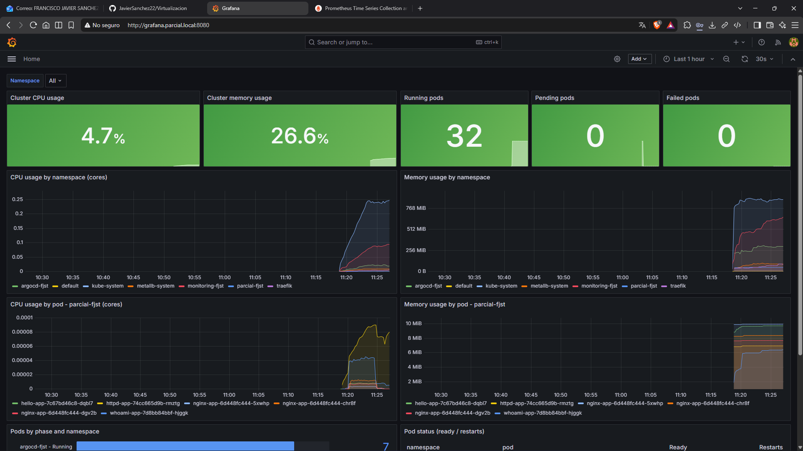
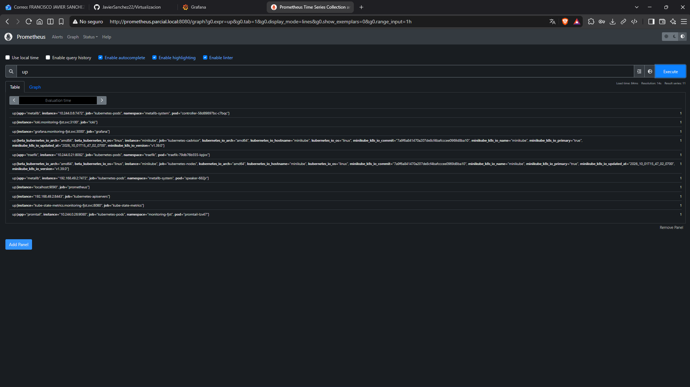
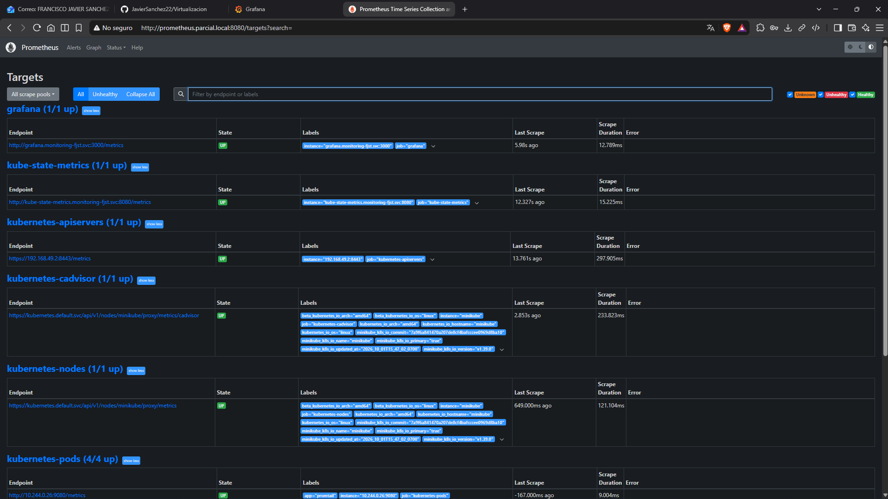
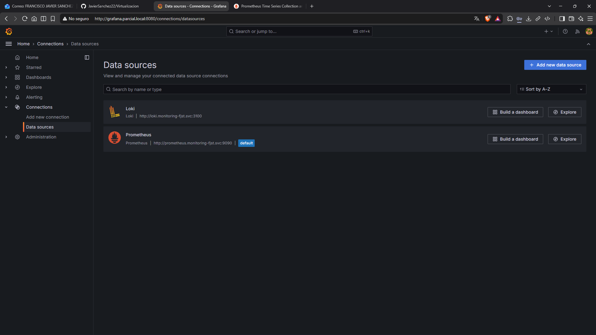
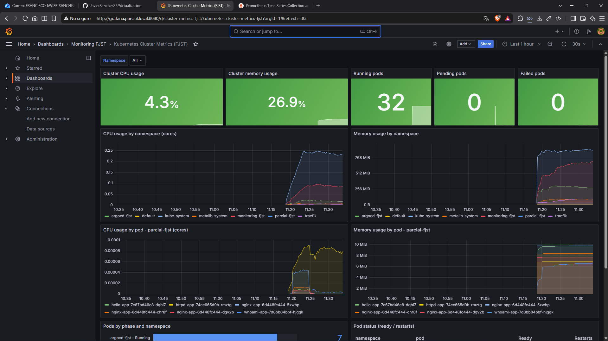
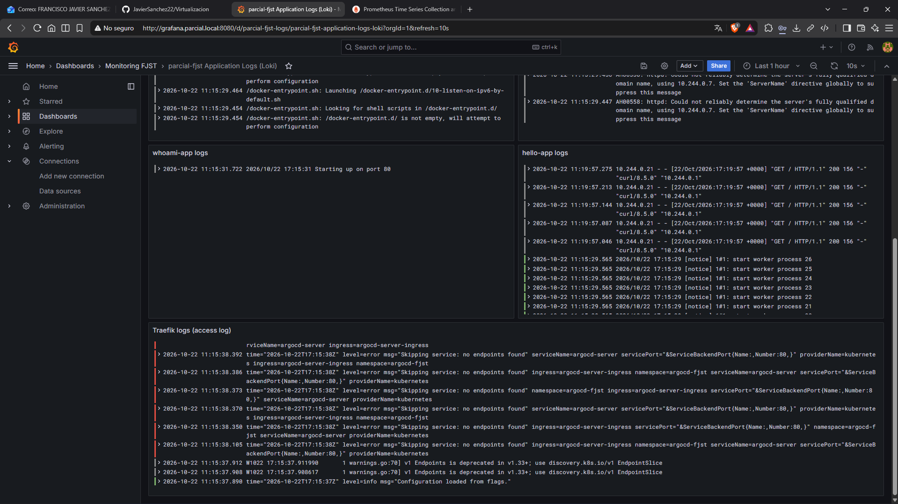

# Personal Project 01 - Monitoring & Centralized Logging on Kubernetes

In this project I implemented a monitoring and log centralization stack inside my local Minikube cluster using **Prometheus**, **Promtail**, **Loki** and **Grafana**. The stack runs on top of the cluster configured in the previous activities (**MetalLB** + **Traefik**), and both Grafana and Prometheus are exposed through Traefik using domain names.

## 1. Environment

| Item | Value |
|------|-------|
| Cluster | Minikube (Docker driver, containerd runtime) running inside WSL2 |
| Minikube node IP | `192.168.49.2` |
| Traefik LoadBalancer IP (MetalLB) | `192.168.49.100` |
| Monitoring namespace | `monitoring-fjst` |
| Applications namespace | `parcial-fjst` |
| Domains | `grafana.parcial.local`, `prometheus.parcial.local` |

> [!NOTE]
> Helm was **not** used. Every component is installed from plain Kubernetes YAML manifests, grouped with a single `kustomization.yaml`, so the whole stack is versioned as IaC in this repository.

---

## 2. Repository Structure (IaC)

```text
.
├── metallb/
│   └── metallb-config.yaml               # IPAddressPool (192.168.49.100) + L2Advertisement
├── traefik/
│   ├── traefik-rbac.yaml                 # Namespace, ServiceAccount, ClusterRole & Binding
│   ├── traefik-deployment.yaml           # Traefik + Prometheus metrics + access logs
│   └── traefik-service.yaml              # LoadBalancer service (192.168.49.100)
├── apps/
│   ├── frontend/                         # nginx-app, httpd-app + Ingress
│   └── demo/                             # whoami-app, hello-app + Ingress
└── monitoring/
    ├── kustomization.yaml                # Entry point: kubectl apply -k monitoring/
    ├── namespace.yaml                    # Namespace monitoring-fjst
    ├── prometheus/
    │   ├── rbac.yaml                     # ServiceAccount + ClusterRole for service discovery
    │   ├── configmap.yaml                # prometheus.yml (scrape configs)
    │   └── deployment.yaml               # Deployment, Service and Ingress (prometheus.parcial.local)
    ├── kube-state-metrics/
    │   └── kube-state-metrics.yaml       # Pod / deployment / node state metrics
    ├── loki/
    │   └── loki.yaml                     # ConfigMap, Deployment and Service
    ├── promtail/
    │   └── promtail.yaml                 # RBAC, ConfigMap and DaemonSet
    └── grafana/
        ├── provisioning.yaml             # Data sources + dashboard provider (provisioning as code)
        ├── deployment.yaml               # Secret, Deployment, Service and Ingress (grafana.parcial.local)
        └── dashboards/
            ├── cluster-metrics.json      # Cluster metrics dashboard (CPU, memory, pod status)
            └── parcial-fjst-logs.json    # Logs dashboard for the 4 apps + Traefik
```

---

## 3. Installation

### 3.1. Start the cluster and base infrastructure
```bash
minikube start
kubectl apply -f metallb/
kubectl apply -f traefik/
```
The apps in `parcial-fjst` were already deployed in the previous activities (managed by Argo CD), and their manifests are also included under `apps/`.

### 3.2. Install the whole monitoring stack
```bash
kubectl apply -k monitoring/
kubectl wait --for=condition=ready pod --all -n monitoring-fjst --timeout=300s
kubectl get pods -n monitoring-fjst
```

Expected result:
```text
NAME                                 READY   STATUS    RESTARTS   AGE
grafana-xxxxxxxxxx-xxxxx             1/1     Running   0          4m
kube-state-metrics-xxxxxxxxx-xxxxx   1/1     Running   0          4m
loki-xxxxxxxxxx-xxxxx                1/1     Running   0          4m
prometheus-xxxxxxxxxx-xxxxx          1/1     Running   0          4m
promtail-xxxxx                       1/1     Running   0          4m
```

---

## 4. Prometheus

**Files:** `monitoring/prometheus/`

- Image `prom/prometheus:v2.54.1`, deployed as a `Deployment` with a `ServiceAccount` and a `ClusterRole` that allows it to discover nodes, pods, services and endpoints, and to read the kubelet metrics through `nodes/proxy`.
- The configuration lives in the `prometheus-config` ConfigMap. Scrape jobs:

| Job | What it collects |
|-----|------------------|
| `prometheus` | Prometheus' own metrics |
| `kubernetes-apiservers` | Kubernetes API server metrics |
| `kubernetes-nodes` | Kubelet metrics (proxied through the API server) |
| `kubernetes-cadvisor` | Container CPU / memory usage (cAdvisor) |
| `kube-state-metrics` | Pod phases, readiness, restarts, node capacity, deployments |
| `loki`, `grafana` | Metrics of the logging/visualization components |
| `kubernetes-pods` | Any pod annotated with `prometheus.io/scrape: "true"` (Traefik and Promtail) |

- **kube-state-metrics** (`monitoring/kube-state-metrics/`) was installed in the same namespace so Prometheus can see the **state of the pods** (Running / Pending / Failed, ready, restarts).
- I enabled Traefik's Prometheus metrics (`--metrics.prometheus=true` on a dedicated `:8082` entrypoint) and annotated its pod so it is scraped automatically.

---

## 5. Loki

**File:** `monitoring/loki/loki.yaml`

- Image `grafana/loki:2.9.10` running in **single-binary** mode (`Deployment` + `Service` on port `3100`).
- Configuration (ConfigMap `loki-config`):
  - `auth_enabled: false` (single tenant).
  - `tsdb` index with `filesystem` object store under `/loki`.
  - In-memory ring with `replication_factor: 1` (single instance).
  - Retention of 72h.

---

## 6. Promtail

**File:** `monitoring/promtail/promtail.yaml`

- Image `grafana/promtail:2.9.10` deployed as a **DaemonSet**, so one Promtail runs on every node of the cluster.
- It mounts the node's `/var/log/pods` directory (read only), where containerd writes every container's logs, and keeps its read positions in `/run/promtail`.
- Its `ClusterRole` allows it to discover pods through the Kubernetes API.
- Log collection configuration (ConfigMap `promtail-config`):
  - `kubernetes_sd_configs` with `role: pod` discovers **all the pods of the cluster**, which includes the 4 apps of `parcial-fjst` and Traefik.
  - Only pods scheduled on the same node are kept (`${HOSTNAME}` = `spec.nodeName`).
  - Relabeling adds the labels `namespace`, `pod`, `container`, `app`, `node` and `job`, and builds the log path `/var/log/pods/*<pod_uid>/<container>/*.log`.
  - The `cri` pipeline stage parses the containerd (CRI) log format.
  - Logs are pushed to `http://loki.monitoring-fjst.svc:3100/loki/api/v1/push`.
- I also enabled Traefik's access log (`--accesslog=true`), so every request routed by Traefik becomes a log line in Loki.

Verification of the `app` labels available in Loki:
```bash
kubectl -n monitoring-fjst exec deploy/grafana -- wget -qO- http://loki:3100/loki/api/v1/label/app/values
# {"status":"success","data":["grafana","hello-app","httpd-app",...,"nginx-app",...,"traefik","whoami-app"]}
```

---

## 7. Grafana

**Files:** `monitoring/grafana/`

- Image `grafana/grafana:11.2.0`. The admin credentials come from the `grafana-admin` Secret (user `admin`, password `admin123`).

### 7.1. Data sources as code (provisioning)
The `grafana-datasources` ConfigMap is mounted in `/etc/grafana/provisioning/datasources`, so both data sources are created automatically at startup (nothing is configured by hand in the UI):

```yaml
apiVersion: 1
datasources:
  - name: Prometheus
    uid: prometheus
    type: prometheus
    url: http://prometheus.monitoring-fjst.svc:9090
    isDefault: true
  - name: Loki
    uid: loki
    type: loki
    url: http://loki.monitoring-fjst.svc:3100
```

### 7.2. Dashboards as code
- The `grafana-dashboard-provider` ConfigMap (mounted in `/etc/grafana/provisioning/dashboards`) tells Grafana to load every JSON file in `/var/lib/grafana-dashboards` into the **Monitoring FJST** folder.
- The dashboard JSON files live in `monitoring/grafana/dashboards/` and are packaged into the `grafana-dashboards` ConfigMap by Kustomize's `configMapGenerator`.

**Kubernetes Cluster Metrics (FJST)** (`cluster-metrics.json`) - Prometheus:
- Cluster CPU usage (%) and memory usage (%).
- Running / Pending / Failed pods.
- CPU and memory usage by namespace (with a `namespace` variable).
- CPU and memory usage by pod in `parcial-fjst`.
- Pods by phase and namespace, and a table with ready status and restarts per pod.

**parcial-fjst Application Logs (Loki)** (`parcial-fjst-logs.json`) - Loki:
- Log lines per minute by app (`parcial-fjst` + `traefik`).
- One logs panel per application: `nginx-app`, `httpd-app`, `whoami-app` and `hello-app` (e.g. `{namespace="parcial-fjst", app="nginx-app"}`).
- Traefik access log panel (`{namespace="traefik"}`).

---

## 8. Exposure through Traefik and Local DNS

Grafana and Prometheus each have an `Ingress` (class `traefik`) that routes by host name to their services, using the LoadBalancer IP provided by MetalLB (`192.168.49.100`):

| Host | Service |
|------|---------|
| `grafana.parcial.local` | `grafana:3000` |
| `prometheus.parcial.local` | `prometheus:9090` |

```bash
kubectl get ingress -n monitoring-fjst
# NAME         CLASS    HOSTS                      ADDRESS          PORTS
# grafana      <none>   grafana.parcial.local      192.168.49.100   80
# prometheus   <none>   prometheus.parcial.local   192.168.49.100   80
```

### 8.1. `/etc/hosts` (Linux / WSL)
I added the 2 new domains pointing to the Traefik LoadBalancer IP:
```bash
echo "192.168.49.100 grafana.parcial.local prometheus.parcial.local" | sudo tee -a /etc/hosts
```

### 8.2. Access from the Windows browser (WSL2)
Because Minikube runs inside WSL2, the `192.168.49.0/24` network is not reachable from the Windows browser. To access it from Windows:

1. Port-forward Traefik in a WSL terminal:
   ```bash
   kubectl port-forward -n traefik svc/traefik 8080:80 --address 0.0.0.0
   ```
2. Add the domains to `C:\Windows\System32\drivers\etc\hosts` (as Administrator):
   ```text
   127.0.0.1 grafana.parcial.local prometheus.parcial.local
   ```
3. Open `http://grafana.parcial.local:8080` and `http://prometheus.parcial.local:8080`.

### 8.3. Generating traffic for the logs
To have fresh logs from the apps I sent a few requests through Traefik:
```bash
for i in $(seq 1 20); do
  for h in nginx httpd whoami hello; do
    curl -s -o /dev/null -H "Host: $h.parcial.local" http://192.168.49.100/
  done
done
```

---

## 9. Screenshots

### 9.1. Grafana accessed through `grafana.parcial.local`


### 9.2. Prometheus accessed through `prometheus.parcial.local`


### 9.3. Prometheus Targets (all UP)


### 9.4. Grafana data sources (provisioned)


### 9.5. Cluster metrics dashboard


### 9.6. Logs dashboard (4 apps of `parcial-fjst`)

